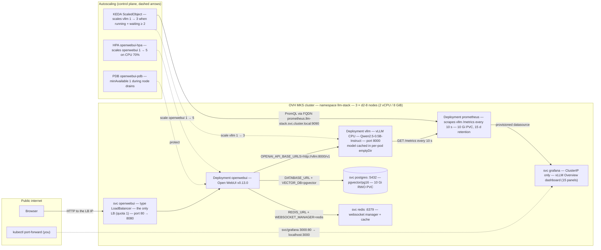

# llm-stack — self-hosted LLM chat on Kubernetes

A complete, self-hosted GenAI stack on a managed Kubernetes cluster (OVH MKS):
a public chat UI (Open WebUI) backed by **vLLM serving Qwen2.5-0.5B on CPU**,
with Postgres (pgvector) + Redis, Prometheus/Grafana observability, and
autoscaling driven by actual request queue depth (KEDA) instead of just CPU.

**Honest scope:** this is a learning/demo project. I deliberately ran it on
**3 small nodes (d2-8: 2 vCPU / 8 GiB, a few €/month)** to keep cost near zero —
and that constraint is the point: it forced real tradeoffs (no RWX storage,
one LoadBalancer, tight memory), each documented below. The architecture and
deploy steps are the same ones you'd use on a real GPU cluster; see
[What changes in production](#what-changes-in-production-with-gpus).



| Component | Image | Role |
|---|---|---|
| Open WebUI v0.13.0 | `ghcr.io/open-webui/open-webui` | public chat UI, the cluster's only LoadBalancer |
| vLLM | `vllm/vllm-openai-cpu` | OpenAI-compatible API on `:8000` |
| PostgreSQL 16 + pgvector | `pgvector/pgvector:pg16` | DB + vector store, 10 Gi PVC |
| Redis 7 | `redis:7-alpine` | websocket coordination / cache, stateless |
| Prometheus | `prom/prometheus` | scrapes `vllm:8000/metrics` every 10 s, 10 Gi PVC |
| Grafana | `grafana/grafana` | internal only; provisioned datasource + 15-panel vLLM dashboard |
| KEDA `ScaledObject` | — | scales vLLM 1→3 when `running+waiting > 2` |
| HPA + PDB | — | Open WebUI 1→5 on CPU 70%; `minAvailable: 1` during drains |

60-second k8s primer: a **Deployment** keeps N **Pods** alive; a **Service**
gives them a stable DNS name; a **PVC** is durable disk (here RWO = single
node); **HPA** scales on resource metrics, **KEDA** scales on any event
(here: a Prometheus query on vLLM's queue).

## Quick start

```bash
export KUBECONFIG=$PWD/config.yml   # your MKS kubeconfig (gitignored; scripts default to ./config.yml)
./stack.sh          # installs KEDA if missing, generates secrets.env, applies manifests/stack.yaml
./stack.sh check    # waits until all pods are ready (first boot downloads the ~1 GB model)
./stack.sh url      # public URL — on the demo cluster: http://148.113.157.185
# sign up in the UI: the FIRST user becomes admin (demo account: admin@demo.local / DemoPass123!)
./dash.sh           # optional: Kubernetes Dashboard at https://localhost:8443
```

Grafana (internal): `kubectl port-forward svc/grafana -n llm-stack 3000:80` →
http://localhost:3000 → Dashboards → "vLLM Overview".

## What's in the repo

```
├── stack.sh               # one-command setup: up | url | check | status | secrets
├── dash.sh                # dashboard helper: open | token | stop
├── manifests/
│   ├── stack.yaml         # the whole stack: ns, 3 PVCs, 6 deployments+services, KEDA, HPA, PDB, Grafana config
│   └── dash.yaml          # dashboard admin ServiceAccount (demo only, never expose)
├── loadtest/
│   ├── run.sh             # phased load test + watcher (pods/HPA/KEDA/metrics every 15 s)
│   └── gen.py             # stdlib-only concurrent load generator (no k6/hey needed)
├── secrets.example.env    # committed template of the secret keys
└── .gitignore             # keeps secrets.env, config.yaml, tokens, loadtest artifacts out of git
```

`secrets.env` (passwords, DB URL, UI key, Grafana admin) is generated by
`./stack.sh`, mode 600, gitignored — only the example template is committed.

## Why it's built this way (real failures on a 2 vCPU / 8 GiB node)

Every non-obvious line in `manifests/stack.yaml` traces to something that
actually broke:

- **No RWX storage exists on OVH** (all StorageClasses are single-attach Cinder
  block) → stateful pods (postgres/grafana/prometheus) use RWO PVCs with
  `Recreate` strategy; anything that scales (vLLM model cache, Open WebUI data)
  uses per-pod `emptyDir`. A second replica on another node would hang forever
  on `FailedAttachVolume`.
- **64 MiB default `/dev/shm` kills vLLM** → memory-backed `emptyDir` (1 Gi) at `/dev/shm`.
- **Naming the Service `vllm` makes kubelet inject `VLLM_PORT=tcp://…`**, which
  vLLM rejects → explicit `VLLM_PORT: "8000"` in the pod env.
- **float32 didn't fit 8 GiB nodes** (OOM/evictions under MemoryPressure) →
  `--dtype bfloat16` (~945 Mi idle) + explicit `--kv-cache-memory-bytes` (512 Mi)
  + limit 6 Gi. A d2-8 has only ~5.9 GiB allocatable.
- **OVH LoadBalancer quota = 1 per project** → exactly one `type: LoadBalancer`
  (Open WebUI); Grafana stays ClusterIP, reached via `port-forward`.
- **KEDA runs in its own namespace** → Prometheus address must be the FQDN
  `http://prometheus.llm-stack.svc.cluster.local:9090`.
- **Open WebUI injects ~4k tokens of tool specs even for "hi"** →
  `--max-model-len 8192`; plus `--enable-auto-tool-choice --tool-call-parser hermes`
  because the UI sends `tool_choice: "auto"`.
- **Octavia LB idle timeout ≈ 50 s vs slow CPU prefill** → `OMP_NUM_THREADS=2`
  (~2× prefill); long prompts can still hit the cutoff — disable builtin tools to
  shrink prompts.

## Load test (proof it scales)

```bash
./loadtest/run.sh    # phases: baseline → 4 → 12 → 24 concurrent → cooldown; artifacts in loadtest/<timestamp>/
```

Result on this 3×d2-8 cluster (artifacts in `loadtest/20261115-042329/`):
at 24 concurrent users, **394/394 requests OK, 1.5 rps, e2e p95 ≈ 23 s**, and KEDA
scaled vLLM 1→2→3 (scale-up takes ~2–3 min/pod due to the per-pod model download).
Open WebUI never left 1 replica — its CPU stayed at 4–9% because it only proxies;
**vLLM is the bottleneck**. Errors seen in lower phases were `RemoteDisconnected`
at exactly ~50 s = the LB idle cutoff when the queue wait exceeded it. After load
stopped, KEDA scaled vLLM back to 1 after its 120 s cooldown; no extra node was
needed (3 × 4 Gi requests fit the 3 nodes).

## What changes in production (with GPUs)

The structure and the steps stay the same — one manifest, one setup script,
KEDA on queue depth, Prometheus→Grafana. What actually changes:

| Demo (this repo) | Production |
|---|---|
| 3 × d2-8 CPU nodes | GPU nodes; `vllm/vllm-openai` (CUDA) image; `--gpu-memory-utilization 0.9` + `--tensor-parallel-size` instead of KV-bytes/dtype tuning |
| Model `Qwen2.5-0.5B`, bfloat16, 8k context | bigger model; same flags, different sizing |
| Model cache = per-pod `emptyDir` (re-downloads ~1 GB per replica) | shared RWX PVC (NFS/Ceph) or S3/HF source so replicas share the cache |
| Open WebUI files in `emptyDir` | S3 (`STORAGE_PROVIDER=s3`) |
| One raw LoadBalancer, plain HTTP | ingress controller on the LB with TLS + hostnames; OIDC auth on Open WebUI; Grafana/dashboard never public |
| `secrets.env` + `kubectl create secret` | Sealed Secrets / SOPS / External Secrets (OVH Secrets Manager, Vault) |
| `latest` image tags, cluster-admin dashboard SA | pinned digests, least-privilege RBAC/OIDC |
| Prometheus 15 d local | remote-write to managed metrics + alerting |
| KEDA threshold 2, max 3 | tune to your latency SLO; on GPU, scale on queue depth still — that part doesn't change |

## Day-2 cheat sheet

```bash
kubectl get pods,svc -n llm-stack                  # state at a glance
kubectl top pods -n llm-stack                      # live usage (metrics-server)
kubectl logs -n llm-stack deploy/vllm --tail=50    # engine logs (--previous for crashes)
kubectl describe pod -n llm-stack <pod>            # events: probes, evictions, FailedAttachVolume
kubectl get scaledobject,hpa -n llm-stack          # autoscaling state
kubectl exec -n llm-stack deploy/openwebui -- curl -s http://vllm:8000/v1/models   # bypass the UI
kubectl apply -f manifests/stack.yaml              # apply changes (idempotent)
kubectl delete -f manifests/stack.yaml && kubectl delete pvc -n llm-stack postgres-data grafana-data prometheus-data  # teardown
```

## What I practiced here

Declarative Kubernetes (Deployments/Services/PVCs/probes), two autoscaling
mechanisms and when to use each (HPA on CPU vs KEDA on a Prometheus queue
query), observability as code (scrape config + provisioned Grafana dashboard in
the manifest), secrets hygiene, a real load test with metrics captured alongside
k8s events, and debugging from actual pod failures on a resource-starved
cluster.